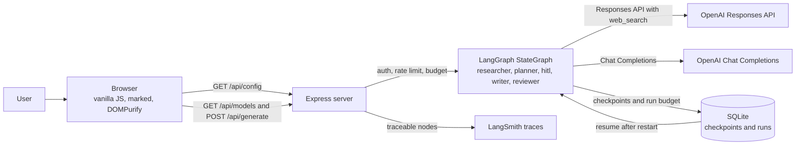

# Architecture

A browser app drives a LangGraph `StateGraph` in Node/Express. The graph runs four editorial agents, pauses for human review at a checkpoint, and streams progress over SSE. Every run is metered, authenticated, and resumable.

## Layers

| Layer | Files | Responsibility |
| --- | --- | --- |
| Transport | `src/server.ts` | HTTP, SSE, auth, rate limiting, request validation, thread lifecycle |
| Orchestration | `src/graph.ts` | Nodes, state, transitions, HITL interrupt, revision loop |
| Models | `src/llm.ts`, `src/models.ts` | Chat model factory, budget-guarded invoke helpers, capability filtering |
| Trusted input | `src/prompt-safety.ts`, `src/citations.ts` | Delimiting untrusted text, length caps, source indexing, citation normalisation |
| Verification | `src/suggestions.ts`, `src/rubric.ts` | Word-level diff verification, fixed weighted judging rubric |
| State | `src/run-store.ts`, `src/persistence.ts` | Durable run registry and SQLite checkpointer |
| Observability | `src/observability.ts` | Structured logs, per-run budget, LangChain usage callback |
| Quality | `evals/`, `tests/` | Deterministic eval corpus and hermetic test suite |
| UI | `public/` | Progress tabs, HITL outline editor, sanitised Markdown rendering |

## Request lifecycle

1. `POST /api/generate` → rate limiter → auth → `GenerateRequestSchema` → model allowlist check.
2. A `threadId` (UUID) and a `RunBudget` are created and registered in the `RunStore` (memory cache over SQLite).
3. The graph is compiled with the SQLite checkpointer and streamed with `streamMode: "updates"`; each chunk becomes one SSE frame.
4. If the run pauses, the server persists `status: "paused"` and returns the `threadId`. Otherwise it sends the article plus the budget summary.
5. `POST /api/generate/continue` → validates `{ threadId, outline }` → loads the run → verifies the checkpoint still exists → resumes with `Command({ resume })`.

## Trust boundaries

| Boundary | Threat | Control |
| --- | --- | --- |
| Internet → API | Anyone burns the operator's OpenAI credit | `APP_API_KEY` (constant-time compare), rate limiting, 64 KB body cap, model allowlist, per-run budgets |
| Browser → graph | Client forges state, skips stages, swaps models | Client sends only `threadId` + outline; all state comes from the checkpoint |
| Web/user text → prompt | Prompt injection, delimiter escape | Untrusted text wrapped in tags, tag-closing neutralised, length-capped, plus an explicit "treat as data" policy |
| Model output → DOM | XSS via retrieved content | DOMPurify + `renderMarkdown()` fallback that escapes when the CDN is blocked; SRI-pinned scripts |
| Model output → report | Fabricated edits | `verifySuggestions()` word-level diff |
| Client → resume | Malformed outline | `OutlineSchema` validation, 400 on failure |

Production fails closed: with `NODE_ENV=production` and no `APP_API_KEY`, the process refuses to start. Without a key it binds to `127.0.0.1` only.

## Durability

LangGraph checkpoints and run budgets live in one SQLite file (`DATA_DIR`, default `data/editorial.sqlite`; `CHECKPOINT_DB=memory` for throwaway dev).

- A paused run survives a restart: graph state from the checkpointer, status and spend from the `runs` table.
- Runs that were `running` when the process died cannot be resumed (no client is attached), so startup drops them.
- A run row without a checkpoint yields **409**, never a half-executed resume.
- A background sweep expires runs idle for 30 minutes.

## Cost control

`RunBudget` accumulates calls, tokens and USD. Limits come from `MAX_LLM_CALLS` (15), `MAX_REQUEST_TOKENS` (120k) and `MAX_REQUEST_USD` (optional), checked *before* each call via `assertCanSpend()`. Pricing resolves from `DEFAULT_PRICING` merged with `MODEL_PRICING_JSON`, so the USD guard is active without configuration. Billable web-search calls are counted separately.

Measured on one article with the default model mix: **7 calls, ~14.5k tokens, ~$0.05**.

## Model strategy

- The researcher uses the Responses API (needed for the `web_search` tool) and records its own usage.
- Everything else uses Chat Completions via `createChatModel()`, which routes reasoning models to the Responses API without a temperature.
- Model choice is per stage, filtered by *capability* (`isSupportedTextModel`) rather than a hard-coded list, so new releases work without code changes.
- Judge ≠ editor, by construction.

## Observability

Structured JSON logs (`node_start`, `node_end`, `llm_call`, `run_paused`, `run_complete`, `run_failed`) carry `thread_id`, latency, tokens and cost. `traceable()` wraps each node for LangSmith when `LANGSMITH_TRACING=true`. The `UsageCallbackHandler` attributes each model call to the node that made it — which only works when the run config is forwarded into the model call, or callbacks never fire.

## Quality

`npm test` is hermetic: 56 tests over pure functions, graph wiring with fake models, HTTP routes (401/400/404/409/429), persistence and budget snapshots.

`npm run eval` runs a golden corpus through the real pipeline with deterministic assertions — citation range, numbers absent from the research, injection canaries, outline structure, required phrases, judge threshold — and writes `evals/report.json` with per-stage cost.

## Trade-offs and next steps

- **SQLite** fits one instance; scaling out needs Postgres for both the checkpointer and the run store.
- **Vocabulary-based coverage** is a proxy. Structure is a hard failure, wording only a warning, deliberately — failing correct paraphrase would make the eval untrustworthy.
- **Next:** require concrete, checkable outline key points in the planner prompt; run `npm run typecheck && npm test` in CI on every PR; attribute judge and editor separately in the budget breakdown.
