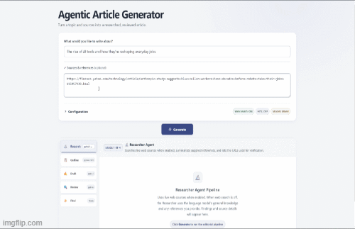

# Agentic Article Generator



Agentic Article Generator turns a topic into a publish-ready article through a LangGraph `StateGraph` workflow. The researcher gathers context, the planner creates an outline, the writer drafts the article, and the reviewer edits and scores it. LangChain provides chat-model integration. You can monitor each stage, choose models, and pause the workflow for human review.

## Requirements

- Node.js 20 or later and npm
- An OpenAI API key with access to the models you want to use
- Docker, if you plan to run the containerized version

## Run Locally

1. Install dependencies from the lockfile:

   ```bash
   npm ci
   ```

2. Copy `.env.example` to `.env` in the project root, then replace the API key placeholder:

   ```dotenv
   OPENAI_API_KEY=your_openai_api_key
   ```

   Do not commit `.env` or share your API key. To use a different port, set `PORT` in this file; the default is `3001`.

3. Start the development server:

   ```bash
   npm run dev
   ```

4. Open [http://localhost:3001](http://localhost:3001) (or the port you configured).

To run the compiled server locally instead, use `npm run build` followed by `npm start`.

## Use the App

1. Enter a topic in the topic field. A topic is required.
2. Optionally add source URLs, reports, books, or other reference notes in **Sources & references**, one entry per line.
3. Open **Configuration** to adjust the workflow.

   **Researcher Agent:** Searches the live web when enabled. Turn it off to skip live web search; if you provide sources, the researcher still uses those references. With web search off and no supplied sources, research is skipped and the workflow starts at planning.

   **Human in the Loop:** When enabled, pauses after the Planner creates the outline so you can review or edit it before the Writer drafts the article. Use **Approve & Continue** to proceed or **Stop Pipeline** to end the run.

   **Models:** Select one model for all stages or expand **Customize each stage** to choose separate researcher, planner, writer, and reviewer models. Use **Refresh models** to reload models available to your API key. Model availability depends on your OpenAI account.
4. Select **Generate**. Follow the Research, Outline, Draft, and Review tabs as the pipeline runs. If the post-review quality score is below 75, the workflow performs one additional writing and review pass.
5. Read the finished article in **Final**. Use **Copy Article** to copy it to the clipboard. Use **Stop generating** to cancel an in-progress generation.

Live web research uses OpenAI's web search tool and may incur API charges. Review generated content and sources before publishing.

## Run with Docker

Copy `.env.example` to `.env` in the project root, then replace the API key placeholder:

   ```dotenv
   OPENAI_API_KEY=your_openai_api_key
   ```

Build the image from the project root:

```bash
docker build -t agentic-article-generator .
```

Run it with the project `.env` file:

```bash
docker run --rm -p 3001:3001 --env-file .env agentic-article-generator
```

Open [http://localhost:3001](http://localhost:3001).

When done.
 Stop the container with `Ctrl+C`. Because the run command uses `--rm`, Docker removes the container automatically when it stops. To remove the image when you're finished, run:

```bash
docker image rm agentic-article-generator
```

If you omitted `--rm`, 
list containers with `docker ps -a`
Stop the container (if it is currently running):
`docker stop <container_id_or_name>`
 remove the stopped container with:
 `docker rm <container_id>`
 Delete the image:
 `docker rmi agentic-article-generator`

## Optional: protect the server with an API key

Every generation spends OpenAI credit on the server's key, so set `APP_API_KEY` before exposing the app to anyone else:

```dotenv
APP_API_KEY=a-long-random-secret
```

The browser then asks for that key under **Configuration → Server API key**. The key is kept in `sessionStorage` for that tab only and sent as an `Authorization: Bearer` header; it is never stored on the server. The app probes `GET /api/config` on load to learn whether a key is needed.

Guardrail behaviour:

- With `NODE_ENV=production` and no `APP_API_KEY`, the server **refuses to start** rather than serving unauthenticated.
- `HOST` defaults to `127.0.0.1` without a key and `0.0.0.0` with one (the container sets `HOST=0.0.0.0`).

## Durable state and human-in-the-loop

A run paused for human review is resumed from a LangGraph checkpoint, not from state held in the browser: the client only sends `{ threadId, outline }`, and the server reloads everything else from disk.

State lives in SQLite (`data/editorial.sqlite` by default) and covers both the checkpoints and each run's budget:

| Variable | Purpose |
| --- | --- |
| `DATA_DIR` | Directory for the SQLite file (Docker uses `/app/data`, a volume) |
| `CHECKPOINT_DB` | Explicit path, or `memory` for ephemeral dev state (paused runs are then lost on restart) |

Runs paused longer than 30 minutes are expired by a background sweep. A run whose checkpoint is missing returns **409** on resume instead of failing obscurely.

## Cost and request guardrails

| Variable | Default | Purpose |
| --- | --- | --- |
| `MAX_REQUEST_TOKENS` | `120000` | Token ceiling per run |
| `MAX_LLM_CALLS` | `15` | Call ceiling per run |
| `MAX_REQUEST_USD` | unset | Cost ceiling per run, using `MODEL_PRICING_JSON` merged over the built-in prices |
| `MODEL_ALLOWLIST` | unset | Comma-separated models the server will accept |
| `RATE_LIMIT_MAX` / `RATE_LIMIT_WINDOW_MS` | `20` / 15 min | Per-client generation limit |
| `WEB_SEARCH_USD_PER_CALL` | `0` | Unit price for billable web-search calls, counted per run |

The USD budget is active out of the box because default prices ship in `src/observability.ts`; override them if your contract differs. Budgets survive a pause and resume.

## Tests and evals

```bash
npm test        # unit and HTTP route tests (no API calls)
npm run typecheck   # type-check src, tests, and evals
npm run eval        # run the golden corpus against the real pipeline
```

`npm test` is hermetic: it stubs auth, uses in-memory state, and never calls OpenAI.

`npm run eval` needs `OPENAI_API_KEY` and runs the cases in `evals/cases.json` through the full graph, asserting deterministic properties rather than trusting a model's self-report:

- every `[n]` citation resolves to a real source;
- every percentage, decimal, year, and thousands-separated number appears in the research (a hallucinated statistic fails the run);
- every outline key point is visibly covered;
- injected instructions, `<script>`, `javascript:` and canaries never reach the article;
- the independent judge's score clears `EVAL_MIN_SCORE` (default 60);
- human-edited outlines and their odd requirements survive to the final article.

Results land in `evals/report.json` with latency, tokens, and cost per case. Useful flags: `--limit N`, `--only <case-id>`.

Unit tests for the checks themselves live in `tests/eval-checks.test.ts`, so the assertions can be trusted before spending money on a run.

## Available npm Scripts

| Command | Purpose |
| --- | --- |
| `npm run dev` | Run the TypeScript server for local development |
| `npm run build` | Compile TypeScript into `dist/` |
| `npm start` | Run the compiled server; build first |
| `npm test` | Run the test suite (hermetic, no API calls) |
| `npm run typecheck` | Type-check sources, tests, and evals |
| `npm run eval` | Run the eval corpus against the real pipeline |
